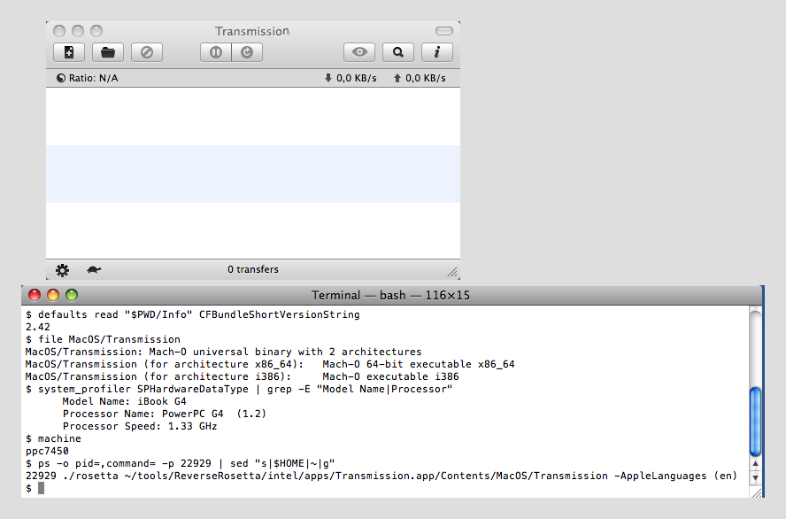
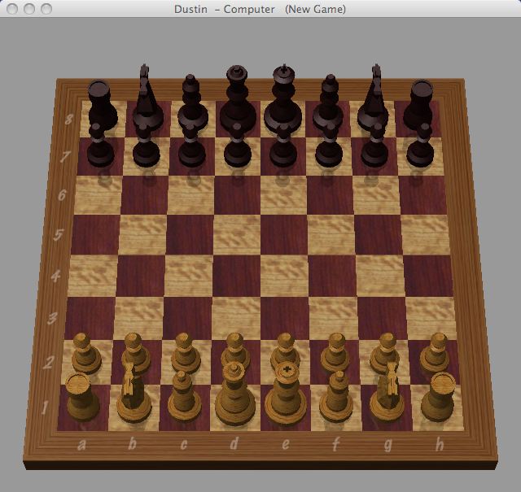

# ReverseRosetta

ReverseRosetta runs Intel (i386) Mac OS X programs on PowerPC Macs. It is a user-mode binary translator for
Mac OS X 10.5 Leopard: it loads an i386 Mach-O program, translates its machine code to PowerPC at run time and
passes system calls and Mach messages to the PowerPC kernel and system services. This is the reverse direction of
Apple's Rosetta, which ran PowerPC programs on Intel Macs.

> **How fast?** Ordinary programs run at about two thirds to four fifths of the speed of their native PowerPC build on
> a G4: gzip 69 %, bzip2 63 to 72 %, perl 67 to 72 %, sort 80 %, Python 98 %. Programs that run for a fraction of a
> second lose most at startup (openssl sha1 38 %), and the first starts of a program are slower while its code is
> translated. Small computing kernels reach 62 to 103 %, OpenGL 80 to 110 %. Details and how it is measured below.



Transmission 2.42 is an Intel-only build (`file` lists x86_64 and i386, no ppc). Above it runs on an iBook G4 with a
PowerPC G4 at 1.33 GHz; `ps` shows the translator process. Both windows are real captures from the same session,
placed at their screen positions.

## Performance

Measured on an iBook G4 (PowerPC 7447A, 1.33 GHz, on mains power at full clock).

### Ordinary programs

Programs of the system on real input (`tests/realworld.sh`): the i386 and the PowerPC part of the same universal binary,
processor time (user and system) of the fastest of 3 runs. `first` is the first run with an empty translation cache,
`cached` a later one. Translated and native output are identical.

| Program | Native | Translated, first run | Translated, cached | Speed vs. native |
|---|---|---|---|---|
| gzip -9 (4 MB of C headers) | 0.65 s | 0.98 s | 0.94 s | 69 % |
| gzip -d | 0.05 s | 0.14 s | 0.10 s | 50 % |
| bzip2 -9 | 2.88 s | 4.68 s | 4.56 s | 63 % |
| bzip2 -d | 0.63 s | 0.95 s | 0.88 s | 72 % |
| sort | 0.39 s | 0.54 s | 0.49 s | 80 % |
| grep -c (regular expression over a dictionary) | 0.06 s | 0.15 s | 0.09 s | 67 % |
| md5 | 0.06 s | 0.12 s | 0.09 s | 67 % |
| openssl sha1 | 0.05 s | 0.22 s | 0.13 s | 38 % |
| openssl aes-128-cbc | 0.12 s | 0.37 s | 0.30 s | 40 % |
| perl (hash, sort) | 0.61 s | 1.00 s | 0.85 s | 72 % |
| perl (regular expression over words) | 0.35 s | 0.64 s | 0.52 s | 67 % |
| python (loop, big integers) | 1.48 s | 1.52 s | 1.51 s | 98 % |

The short runs are coarse (processor time has a resolution of 10 ms). The same input ten times (40 MB), where startup
no longer counts: openssl sha1 1.05 s against 0.43 s natively (41 %), aes-128-cbc 2.85 s against 1.11 s (39 %), md5
0.76 s against 0.61 s (80 %), gzip -9 9.26 s against 6.48 s (70 %).

Short runs are dominated by startup: dyld, libSystem and the libraries run translated, and even with everything
translated a program like openssl needs about 40 ms more than natively before it does any work. Compute-heavy C code
with many stack operands (i386 has seven general registers) runs at 55 to 70 %: every local in memory costs a
byte-reversed load or store that native PowerPC code keeps in a register. Within a block the translation reads stack
slots back from registers, computes read-modify-writes of a slot in the register that holds it and takes bytes of a
slot from there too (loops keep slots in registers throughout); OpenSSL's hash and cipher code, nearly all stack
traffic, reaches about 40 %. The Python of /usr/bin is PowerPC-only; the i386 one comes from the Intel root.
sqlite is not in the table: the PowerPC library of an updated 10.5.9 is sqlite 3.7, the i386 one of the 10.5.8 update
sqlite 3.4, which lacks automatic indexes (the same query 0.06 s natively, 17 s translated).

### Computing kernels

The upper bound: small C programs built twice from the same source with gcc-4.2 -O2, once for i386 and run
translated, once natively for PowerPC. Both builds print the same result, which the measurement compares. Hot loops
that fit the translator's optimizations; ordinary programs reach less (see above).

| Benchmark | What it does | Translated | Native | Speed vs. native |
|---|---|---|---|---|
| `bench_integer` | integer arithmetic, loops, arrays: sieve, hashing, sorting, Collatz | 1925 MIPS | 1878 MIPS | **103 %** |
| `bench_calls` | direct calls, calls through function pointers (one and changing targets), recursion | 1144 MIPS | 1434 MIPS | **80 %** |
| `bench_control_flow` | recursion, qsort with a compare callback, a switch-table machine, strtok | 946 MIPS | 1267 MIPS | **75 %** |
| `bench_libm` | sin, cos, exp, log, pow, atan2, fmod, floor, sqrt with x87 return values | 271 MIPS | 397 MIPS | **68 %** |
| `bench_sse2` | packed SSE2 doubles: daxpy, dot product, complex multiply, sqrt/div, min/max, compares | 210 MIPS | 339 MIPS | **62 %** |
| `bench_float` | matrix product, n-body with sqrt, float vectors, int/float conversions | 270 MIPS | 437 MIPS | **62 %** |

MIPS is the number of i386 instructions per round (counted by the interpreter) divided by the time per round; the
time per round is the slope between a short and a long run, so startup costs drop out. The native column uses the
same instruction count with the native run time, so the last column is the ratio of the run times. Fastest of 3
runs; the values vary by a few percent between measurement runs. `tests/measure_all.sh` repeats the measurement.

### Libraries and OpenGL

Library code: decoding a 2560x1600 JPEG with ImageIO and drawing it into a bitmap (`tools/probes/jpeg_decode.c`)
takes 1.47 s translated and 0.44 s native. ImageIO's decoder is SSE2 code; before packed SSE2 integer and float
instructions were translated to AltiVec, it took 16.3 s. QuickTime opening two H.264 movies and decoding frames of
them (`tests/quicktime.c`): 3.43 s translated, 1.52 s native; its codecs' MMX code went through the interpreter
before (3.82 s).

OpenGL (`tests/bench_gl.c`, `tests/gl_measure.sh`): 13 workloads drawn by the Radeon 9200 into a 256x256 pbuffer,
milliseconds per frame, fastest of 5 rounds. Translated and native builds render identical images. Where the native
build waits for the graphics chip, the translated one is limited by the processor; interleaved arrays are faster
than native because rosetta converts them in cache-sized pieces, which the driver then copies from the cache.

| Workload | Translated | Native | Speed vs. native |
|---|---|---|---|
| immediate mode, `glColor3f`/`glNormal3f`/`glVertex3f` | 9.08 ms | 7.27 ms | 80 % |
| immediate mode, vectors (`glColor4ubv`, `glVertex3fv`) | 6.22 ms | 5.95 ms | 96 % |
| immediate mode, textured | 7.47 ms | 6.54 ms | 87 % |
| matrix and state changes | 10.54 ms | 10.30 ms | 98 % |
| display lists | 12.94 ms | 12.96 ms | 100 % |
| vertex arrays, `glDrawArrays` | 2.75 ms | 2.62 ms | 95 % |
| `glDrawElements` (16-bit indices) | 9.33 ms | 9.17 ms | 98 % |
| vertex buffer object | 1.97 ms | 1.95 ms | 99 % |
| interleaved arrays (stride 28) | 2.77 ms | 3.03 ms | 109 % |
| buffer object refilled every frame | 3.11 ms | 2.82 ms | 91 % |
| texture upload 256x256 BGRA | 6.27 ms | 5.10 ms | 81 % |
| `glReadPixels` 256x256 | 17.45 ms | 15.68 ms | 90 % |
| `glGet` | 1.23 ms | 0.96 ms | 78 % |

### Startup

Startup time, translated against native, fastest of 7 runs with the translation cache filled:

| Program | Translated | Native |
|---|---|---|
| hello world (libSystem) | 23 ms | 12 ms |
| CoreFoundation test | 41 ms | 18 ms |
| Objective-C test | 29 ms | 14 ms |
| Foundation test | 73 ms | 46 ms |
| `/bin/ls -la /usr/lib` (i386 part of the universal binary) | 70 ms | 42 ms |

Programs with windows, time until the program is idle after the start (the translator's own measurement,
`ROSETTA_STATS`, nothing else running), starting with an empty translation cache: wall time / processor time. The first
start interprets code for 300 ms and translates from then on; the second translates what the first only interpreted;
from the third start on almost nothing is translated:

| Program | 1st start | 2nd start | from the 3rd start |
|---|---|---|---|
| Calculator.app | 5.7 s / 4.3 s | 2.1 s / 1.4 s | 2.0 s / 1.4 s |
| Transmission 2.42 | 10.4 s / 7.4 s | 3.5 s / 3.1 s | 3.5 to 4.0 s / 3.0 s |
| Firefox 16.0.2 (a local page) | 12.8 s / 9.2 s | 8.1 s / 2.7 s | 2.8 to 6.0 s / 1.1 to 2.7 s |

Transmission's wall time includes waiting for name lookups (DirectoryService answered its three queries in 1.4 s
in one start); its processor time is what the translation costs. Firefox's startup alone is 30 MB of translated code
(110,000 blocks); its translation cache holds up to 32 MB, the first half of the code region, and a start that loads it
translates only the code its JavaScript JIT generates and what differs from run to run (1,000 to 6,000 blocks); when
it is idle for the first time varies with the page and the JIT. Measured on 17 Nov with the translator of that day.

Measured from outside in the same way for both (the window polled every 0.2 s, which costs processor time
itself), Calculator's window appears after 3.6 to 3.9 s with a filled translation cache and after 2.3 to 2.6 s for
the native PowerPC build (measured on 16 Nov). At startup the translated Calculator uses 1.4 s of processor time once
its translation cache is filled (4.3 s at the very first start; measured on 17 Nov), the native one 0.66 s.

## What runs

- Command-line programs: the i386 parts of the universal binaries in Mac OS X. `tests/cli_matrix.sh` runs every one
  of them in `/bin` and `/usr/bin` plus about 120 real workloads (text tools, archives, compression, Perl, Python,
  Ruby, Tcl, sqlite, openssl, plists) translated and natively and compares the output byte for byte; see
  [Tests](#tests) for the current result.
- C programs with libSystem, libm, pthreads, signals (handlers, masks, `sigwait`, exceptions such as division by zero
  and memory faults delivered to the program's handler), sockets, `select`/`poll`/`kqueue`, file locks, POSIX
  semaphores, terminals.
- Processes: `fork`, `vfork`, `execve`, `posix_spawn`, `system`, `popen`. A program that runs on PowerPC is started
  natively; an Intel-only program runs through rosetta again, with its own `argv[0]`, signal mask and ignored signals.
- CoreFoundation, Objective-C and Foundation, taken from Apple's Intel frameworks (see below), including
  `NSThread` and `NSOperationQueue`.
- Cocoa programs with windows, events and text. Of the Intel applications of the 10.5.8 update, Calculator (computing
  with the system's own engine), Terminal, Console, System Profiler, Dictionary, iCal, Address Book, Safari, Mail and
  Keychain Access open their windows; Preview shows PDF documents; Chess draws its board with OpenGL. Transmission 2.42 downloads.
  Firefox 16.0.2 (the last release for 10.5, Intel only) opens its window and renders pages with canvas drawing; its
  JavaScript JIT generates x86 code that rosetta translates in turn (a test loop of 3 million iterations gives the
  right result in 1.9 s). Safari shows pages
  over HTTP with CSS, JavaScript and images (HTTPS to current servers fails on 10.5 natively too). Programs open
  documents and URLs in other applications through LaunchServices (a game's Read Me opens in TextEdit), with the
  quarantine labels of downloaded files read and written as natively. Text rendering goes through the system's
  PowerPC font server; font metrics, glyph outlines, paths and the bitmap glyphs of small text without antialiasing
  are identical to a native build (`tests/fonts.c`).
- Installed universal applications through their i386 part (`tests/app_survey.sh`, `tools/apps_i386.sh`): all 49 on
  the test machine behave as their native builds. 45 open their windows within 40 seconds, among them Keynote, Pages
  and Numbers ('09), Xcode 3.1, Interface Builder, Dashcode, Instruments, Quartz Composer, Shark, FileMerge,
  PackageMaker, Icon Composer, Mail, BigTop, Cinebench R10, SheepShaver, The Unarchiver and The Sims 2 Body Shop (its
  licence dialog); MallocDebug, OpenGL Driver Monitor and Saturn open no window at launch, natively neither, and The
  Sims 2's Read Me opens its document in TextEdit and quits, as it does natively. Objective-C
  garbage collection (Xcode) and JavaScriptCore work. Frameworks that the 10.5.8 update has no i386 version of are stub
  libraries with real Objective-C classes (see Limitations); an application that needs one of them for real fails at
  that point.
- Sound: OpenAL through the system's PowerPC OpenAL (`tests/openal.c`), and CoreAudio's device layer (HAL) through the
  system's HAL, so that AudioUnit output (SDL, games), AudioQueue and QuickTime's sound run on the real hardware
  (`tests/coreaudio.c`: render callbacks and queue callbacks as natively).
- Text encodings: CFString conversions in i386 code, the Text Encoding Converter (TEC*) through the system's CarbonCore,
  whose encoding plugins exist only for PowerPC (`tests/textenc.c`: MacRoman, Shift-JIS, EUC-CN, EUC-KR, UTF-8/16).
- QuickTime through its own i386 framework from Apple's QuickTime 7.6.4 for Leopard (see Setup): movies open, and
  H.264 frames decode to the same pixels as natively (`tests/quicktime.c`); QuickTime Player's own i386 build opens its
  window, and the QuickTime messages of Cinebench, Keynote and Numbers are gone. Its codecs use MMX, which the
  translator does with AltiVec like SSE2 (`tests/mmx_ops.c` against a real x86 processor).
- x87, SSE and SSE2: scalar, packed double, packed integer and packed float (AltiVec), including Apple's Intel
  vDSP/vForce code and ImageIO's image decoders.
- OpenGL with the graphics chip: the program's OpenGL calls go to the system's PowerPC OpenGL and its hardware
  renderer (a Radeon 9200 on the test machine): immediate mode, vertex arrays, buffer objects, display lists,
  textures, pixel transfers, GLU. Windows (NSOpenGLView, CGL) and pbuffers. Images rendered by
  `tests/bench_gl.c` are identical to those of the native build.

Intel programs see an Intel Mac: CPUID, the commpage, `hw.cputype`, `hw.optional.*` and `host_info` describe an
Intel Core Duo with SSE3, `arch` prints `i386`, `uname -m` prints `i386`. Programs that check the processor
therefore take their Intel code paths, as on Apple's Rosetta, which showed PowerPC programs a PowerPC.




## How it works

- An interpreter runs code the first few times; blocks that run often are translated to PowerPC (block chaining,
  inner jumps, lazily computed x86 flags, x87 and SSE values kept in PowerPC floating-point registers within a block,
  AltiVec for byte swapping and for packed SSE2 integer and float instructions, native stubs for frequent libSystem
  string and math functions).
- Translated code is stored in a translation cache under `~/Library/Caches/rosetta` and mapped back in on the next
  start of the same program. Besides at the end, it is written after 6 and 45 seconds of run time and at the first
  idle moment, so programs that are closed by a signal or at logout keep their translations too. Each block records
  the guest pages it was translated from; when a library lands at a different address than in the saved run, only
  the blocks that rely on those pages are translated again.
- System calls (BSD and Mach traps) are converted between the byte orders. Mach messages are converted header by
  header; MIG messages are converted by MIG itself (NDR record). Messages to the font server (ATS) are converted
  field by field from a layout table.
- The i386 dyld, libSystem and frameworks run translated. They talk to the native PowerPC services: WindowServer,
  ATSServer, securityd, launchd, syslogd.
- Threads run one at a time under a global lock; a watchdog thread interrupts long loops for signal delivery.
- OpenGL: the Intel OpenGL framework is not loaded. Each of the 759 entries of the dispatch table (generated from
  the SDK headers by `tools/gl_gen.py`) reads its arguments from the Intel stack and calls the host context's entry
  directly. Vertex data is converted at the draw call, in pieces that stay in the processor cache while the driver
  copies them; buffer objects keep a copy in Intel byte order and are converted per attribute layout; pixel data is
  swapped by the driver's own byte swapping. The window's WindowServer connection is shared between the Intel and
  the PowerPC CoreGraphics by redirecting the host's messages.
- System structures that differ in byte order are converted where the guest reads them: `sysctl` results
  (`kinfo_proc`, routing messages for `getifaddrs`, load average, swap usage, `vfsconf`, `nfsstats`), `kevent`, `flock`, `termios`,
  `/var/run/utmpx`. Intel frameworks that treat the missing EFI device tree node as fatal get the device tree root
  instead (AppKit otherwise hangs when a program starts its first `NSThread`).

[DESIGN.md](DESIGN.md) describes the design, the measurements behind each decision and the problems found on the way.

## Requirements

- A PowerPC Mac with a G4 or G5 (AltiVec is required; the build uses -mcpu=7450) and Mac OS X 10.5.8. Developed and
  tested on an iBook G4 (7447A, 1.33 GHz, 1.25 GB RAM) with Mac OS X 10.5.9 (build 9L31b, based on 10.5.8).
  G3 Macs are not supported. G5 Macs are untested; the optimizations are tuned to the costs of the 7447A.
- The Intel frameworks come from the 10.5.8 update and talk to the system's own WindowServer, font server and
  securityd. Earlier Leopard versions are untested and likely to fail; Mac OS X 10.4 is not supported.
- Xcode 3.1 with gcc-4.2 and the Mac OS X 10.5 SDK. The SDK contains the i386 stub libraries needed to link i386
  test programs.
- About 3 GB of free disk space for the Intel libraries.

## Getting the Intel libraries

Mac OS X 10.5 on PowerPC contains i386 code only for a few command-line tools and system libraries. The Intel
frameworks (CoreFoundation, Foundation, AppKit, CoreGraphics ...) come from Apple's Mac OS X 10.5.8 Combo Update,
which is a universal package. It is unpacked, not installed; the running system is not changed. No Apple software is
part of this repository.

1. Download `MacOSXUpdCombo10.5.8.dmg` (797 MB) from Apple's support download page "Mac OS X 10.5.8 Combo Update"
   (support.apple.com/106460) and put it into `intel/download/`.
2. Unpack it (shows the package signature, which chains up to Apple Root CA):

   ```
   tools/intel_unpack.sh intel/download/MacOSXUpdCombo10.5.8.dmg
   ```

3. Build the Intel root `intel/root` from it. The translator redirects the guest's file accesses below
   `/System/Library`, `/usr/lib` and `/Library` to this directory when a file exists there:

   ```
   tools/intel_root.sh            # thin i386 copies of every Mach-O file of the update
   tools/intel_links.sh           # symbolic links of the framework bundles
   tools/intel_prune.sh           # remove what the system already provides as i386 (libSystem, libobjc, dyld)
   tools/intel_replacements.sh    # vImage, libBLAS, libLAPACK, MLTEFile replacements (missing from the update)
   tools/intel_umbrellas.sh       # umbrella frameworks (CoreServices, ApplicationServices, Carbon, Cocoa)
   tools/intel_rebase.sh          # fixed load addresses for all i386 libraries
   tools/intel_prebind.sh         # prebinding (binding in dyld for Foundation: 14.3 ms -> 1.8 ms)
   tools/intel_patch.sh           # three patches, see below
   ```

   Run `tools/intel_patch.sh` again after every `intel_rebase.sh` or `intel_prebind.sh`.

   QuickTime (optional, for programs that play movies or use QTKit): Apple's "QuickTime 7.6.4 for Leopard" is a
   universal package whose i386 part the 10.5.8 update lacks. `tools/intel_quicktime.sh QuickTime764_Leopard.dmg`
   puts it into the root (nothing is installed; download link and checksum in the script).

The three patches change copies in `intel/root`, never the system. Each one checks the original bytes and keeps a
backup in `intel/backup/`:

1. CoreGraphics 409.3 (10.5.8) refuses to connect to the WindowServer of a different version (409.8 on the test
   machine). The version check is relaxed.
2. Security.framework sends its protocol version to the PowerPC securityd in a form that securityd's byte-swapping
   mode reads correctly.
3. LaunchServices waits forever for the EFI device tree entry (`IODeviceTree:/efi`), which a PowerPC Mac does not
   have. The wait is skipped.

## Building

```
./build.sh          # builds build/rosetta
./build.sh tests    # also the test programs, each as i386 and as native PowerPC build
```

## Running programs

```
build/rosetta /usr/bin/sort -n numbers.txt
build/rosetta build/hello a b
```

### Programs with windows

One step sets up an Intel program and puts a launcher into `~/Applications/Intel`, which starts it with a double
click in the Finder, from the Dock or with `open`, like any other program:

```
tools/install_app.sh Transmission-2.42.dmg     # a disk image, a .zip, an .app bundle ...
tools/install_app.sh Preview                   # ... or an application of the Combo Update by name
open ~/Applications/Intel/Transmission.app
```

`install_app.sh` copies the program to `intel/apps/`, reports i386 libraries that neither the Intel root nor the
system has, builds stub libraries for them (and adds the program's symbols to existing ones) and creates the
launcher (`tools/finder_app.sh NAME` makes the launcher alone). The launcher is a small bundle with the program's
name and icon whose executable starts rosetta; the program runs from `intel/apps/`. Apple Events reach the
translated program: it opens documents (`open -a ~/Applications/Intel/Preview.app file.pdf`, a URL for Safari) and
quits through AppleScript (the Dock and logout send the same event). A few programs need more:
`tools/intel_umbrellas.sh Quartz` for frameworks that exist only as an umbrella, `tests/transmission_setup.sh` (no
router port mapping, no update check).

From an SSH login, `tests/in_session.sh SCRIPT` runs a shell script inside the login session (`launchctl submit` on
the session's launchd, no root needed); `tests/app_start.sh NAME` starts a program there with its output in
`/tmp/app_NAME.log`. Step by step, as `install_app.sh` does it:

```
tools/intel_app.sh Calculator          # Intel build from the Combo Update plus resources from /Applications
tools/app_deps.sh Calculator           # i386 libraries that are still missing
tools/stubs_rebuild.sh                 # all stub libraries for all programs at once (slow)
build/rosetta intel/apps/Calculator.app/Contents/MacOS/Calculator
```

Stub libraries stand in for i386 libraries that are neither in the update nor in the system (SpeechRecognition,
Tcl, OpenDirectory ...; QuickTime, QTKit and CoreVideo until `tools/intel_quicktime.sh` has replaced them). Their
functions report `rosetta-stub: NAME missing` on the first call and return an error code.

### Environment variables

| Variable | Effect |
|---|---|
| `ROSETTA_INTEL=DIR` | Intel root (default: `intel/root` next to the `build` directory); `-` disables the redirection |
| `ROSETTA_INTERP=1` | interpreter only, no translation |
| `ROSETTA_THRESHOLD=N` | number of executions before a block is translated (default 10, after 300 ms 1: `ROSETTA_THRESHOLD_LATE`, `ROSETTA_THRESHOLD_MS`) |
| `ROSETTA_NO_CACHE=1` | do not read or write the translation cache |
| `ROSETTA_CACHE_SHOW=1` | report why a cached translation is used or rejected (`=2`: every new and every discarded block) |
| `ROSETTA_NO_CHECKPOINT=1` | write the translation cache only at the end |
| `ROSETTA_CACHE_FILE=FILE` | use this file as the translation cache (tests) |
| `ROSETTA_CACHE_MAX_MB=N` | translation caches of all programs together at most N MB (default 256; the ones used longest ago are deleted) |
| `ROSETTA_CACHE_CAP_MB=N` | code in one program's translation cache at most N MB (default: the first half of the 64 MB code region) |
| `ROSETTA_HOST_CPU=1` | show the guest the real PowerPC processor instead of the Intel one |
| `ROSETTA_STATS=1` | translator counters and times at exit; at the first idle moment processor time, page faults, system calls, Mach messages by id and interpreted opcodes of the startup |
| `ROSETTA_LOG=1` | log of system calls and Mach traps, with paths and service names (`=2`: with time and thread, `=3`: also the words of every Mach message) |
| `ROSETTA_ATS_LOG=1` | every message to the font server, in the server's byte order (`2`: longer dumps, `3`: changed shared memory) |
| `ROSETTA_HPROFILE=FILE` | sampling profile of the translator and the guest (`ROSETTA_HPROFILE_CPU=1`: processor time) |
| `ROSETTA_STATE=1` | `kill -USR2` prints where every guest thread is (for programs that hang) |
| `ROSETTA_CRASH_STDERR=1` | crash details on stderr instead of `~/Library/Logs/rosetta/PROGRAM-PID.txt` |
| `ROSETTA_HALT=ADDR,...` | interpreter only; show registers and stack at these guest addresses |

`ROSETTA_NO_*` switches turn off single optimizations; they are listed at the top of `jit.c`.
`tools/which_image.sh ADDRESS...` names the Intel library and offset of addresses from a crash report.

## Tests

```
tests/run_tests.sh      # 54 comparisons against native builds, real Intel output or the interpreter
tests/measure_all.sh    # the benchmark loads above
tests/gl_measure.sh     # the OpenGL workloads, translated and native side by side (login session)
tests/realworld.sh      # ordinary programs (gzip, bzip2, perl, python ...) translated against native
tests/app_survey.sh     # start installed applications through their i386 part (login session), windows and crashes
tests/cli_matrix.sh     # every universal command line program of the system, translated against native
```

`run_tests.sh` compares each test program translated against the same source built for PowerPC (or against the
interpreter, or against output recorded on an Intel Mac). `tests/syscalls.c` alone covers processes, `kqueue`, file
locks, semaphores, blocked signals, terminals and the converted `sysctl` structures. The font and OpenGL tests run
only when a login session exists; the OpenGL test compares the images of every workload of `tests/bench_gl.c`.

`cli_matrix.sh` runs each command natively, translated, and natively again (output that changes between the native
runs, such as a clock, is set aside) in an empty working directory, without arguments and with input from
`/dev/null`; programs that could send mail, print, change settings or start services are never run. Current result
on the iBook: 593 of 644 commands give byte-identical output and exit status, 15 change between native runs. Most of
the rest differ on purpose (they report the Intel processor: `arch`, `machine`, `uname`, compiler driver names; the
i386 part of `full2tt6e` is a placeholder that only prints "unsupported architecture"),
need Intel libraries that the update does not contain (AppleTalk, Tcl, OpenDirectory, Samba), or crash natively as
well.

## Limitations

- i386 only; x86_64 code is not supported.
- Memory faults (SIGSEGV, SIGBUS) reach the program's handler, but inside translated code the state the handler sees
  is approximate (registers exact, eip the start of the translated block). A handler that returns to retry the access
  (SheepShaver's screen tracking, write barriers of garbage collectors) works: the access runs again exactly
  (`tests/fault_retry.c`). One that ends the program or jumps away with `siglongjmp` works; one that changes the
  context to continue elsewhere continues from that approximate state.
- Guest and translator share one address space: memory the guest gives back with `munmap` can be reused by the
  translator, so a later access there does not always fault as it would natively.
- Threads do not run in parallel (global lock). The test machine has one CPU core.
- Multiprocessor Macs (dual G4, dual and quad G5) are untested. The handshake between the watchdog thread and
  running translated code assumes a single CPU and uses no memory barriers; rare crashes or hangs are possible there.
- Accessibility (System Events, assistive devices) does not see the windows of translated programs.
- Frameworks that neither the 10.5.8 update nor the QuickTime 7.6.4 package contain as i386 (Tcl, OpenDirectory,
  SpeechRecognition ...) are stubs; features that need them do not work. Their functions report
  `rosetta-stub: NAME missing` once and return an error code, their Objective-C classes exist with the right superclass and answer unknown messages with nil
  (`tools/sdk_stubs_all.sh`, `tools/app_stubs.sh`, `tools/stubs_rebuild_all.sh`). Calculator's engine is the exception: it runs as the native
  PowerPC function.
- Programs with windows start slowly the first two times (see the table under Performance). With the translation
  cache filled, Calculator still uses about 2 times the processor time of the native build at startup, most of it
  in translated guest code (dyld binding, the Objective-C runtime, CoreFoundation).
- OpenGL: immediate mode with scalar arguments and glGet reach about 80 % of the native speed (the table under
  Performance). Tested with NSOpenGLView windows and CGL pbuffers; AGL and GLUT programs are untested.
- The keychain sees the process `rosetta`, not the program: a program that reads a password asks once per item, and
  "Always Allow" lets every translated program read it. After rosetta is rebuilt, the keychain asks again.
- Real-time threads of translated programs run as ordinary time sharing (`ROSETTA_REALTIME=1` passes the request on):
  translated code is slower than the computation such a thread promises, and an overrunning real-time thread froze the
  whole iBook as soon as QuickTime decoded a movie.
- CoreAudio properties that carry pointers (value translations such as device by UID) are not bridged and report
  kAudioHardwareUnknownPropertyError; names and UIDs (CFString) are.
- expect and tclsh need Tcl.framework, which has no i386 version on a PowerPC system (the Intel root has a stub).
- Programs that need a setuid helper in their bundle (Activity Monitor's pmTool) do not work: the copy in
  `intel/apps` is not setuid, and an i386 helper could not run with root rights through rosetta anyway.
- Packed float instructions give the PowerPC default NaN (positive) where Intel processors give a negative one.
- Font server: a few rarely used message types are passed through unconverted and reported once.

## License

MIT License, see [LICENSE](LICENSE). The Intel libraries the translator needs are not part of this repository; they
come from Apple's own update under Apple's terms (see [Getting the Intel libraries](#getting-the-intel-libraries)).

Apple, Mac, Mac OS X, macOS and Rosetta are trademarks of Apple Inc. This project is not affiliated with or
endorsed by Apple. Transmission is a trademark of its respective owners.
