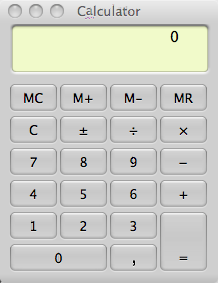

# ReverseRosetta

ReverseRosetta runs Intel (i386) Mac OS X programs on PowerPC Macs. It is a user-mode binary translator for
Mac OS X 10.5 Leopard: it loads an i386 Mach-O program, translates its machine code to PowerPC at run time and
passes system calls and Mach messages to the PowerPC kernel and system services. This is the reverse direction of
Apple's Rosetta, which ran PowerPC programs on Intel Macs.

> **Translated Intel code runs at up to native speed on a PowerPC G4.** Integer code reaches 102 % of the speed of the
> same program compiled natively for PowerPC, call-heavy code 83 %, control flow 72 %, packed SSE2 code 68 %, libm
> code 67 %, floating point 60 %. A Foundation program starts in 69 ms (native: 47 ms).


Transmission 2.42 is an Intel-only build (`file` lists x86_64 and i386, no ppc). Above it runs on an iBook G4 with a
PowerPC G4 at 1.33 GHz; `ps` shows the translator process. Both windows are real captures from the same session,
placed at their screen positions.

## Performance

Measured on an iBook G4 (PowerPC 7447A, 1.33 GHz). Each benchmark is a C program built twice from the same source
with gcc-4.2 -O2: once for i386 and run translated, once natively for PowerPC. Both builds print the same result,
which the measurement compares.

| Benchmark | What it does | Translated | Native | Speed vs. native |
|---|---|---|---|---|
| `bench_integer` | integer arithmetic, loops, arrays: sieve, hashing, sorting, Collatz | 1919 MIPS | 1880 MIPS | **102 %** |
| `bench_calls` | direct calls, calls through function pointers (one and changing targets), recursion | 1170 MIPS | 1416 MIPS | **83 %** |
| `bench_control_flow` | recursion, qsort with a compare callback, a switch-table machine, strtok | 903 MIPS | 1262 MIPS | **72 %** |
| `bench_sse2` | packed SSE2 doubles: daxpy, dot product, complex multiply, sqrt/div, min/max, compares | 209 MIPS | 307 MIPS | **68 %** |
| `bench_libm` | sin, cos, exp, log, pow, atan2, fmod, floor, sqrt with x87 return values | 265 MIPS | 396 MIPS | **67 %** |
| `bench_float` | matrix product, n-body with sqrt, float vectors, int/float conversions | 261 MIPS | 433 MIPS | **60 %** |

MIPS is the number of i386 instructions per round (counted by the interpreter) divided by the time per round; the
time per round is the slope between a short and a long run, so startup costs drop out. The native column uses the
same instruction count with the native run time, so the last column is the ratio of the run times. Fastest of 3
runs; the values vary by a few percent between measurement runs. `tests/measure_all.sh` repeats the measurement.

Startup time, translated against native, fastest of 7 runs with the translation cache filled:

| Program | Translated | Native |
|---|---|---|
| hello world (libSystem) | 23 ms | 13 ms |
| CoreFoundation test | 41 ms | 18 ms |
| Objective-C test | 29 ms | 14 ms |
| Foundation test | 69 ms | 47 ms |
| `/bin/ls -la /usr/lib` (i386 part of the universal binary) | 71 ms | 42 ms |

Programs with windows, time until the program is idle after the start (the translator's own measurement,
`ROSETTA_STATS`, nothing else running), starting with an empty translation cache. The second start translates
everything the first one only interpreted; from the third start on almost nothing is translated:

| Program | 1st start | 2nd start | from the 3rd start |
|---|---|---|---|
| Calculator.app | 4.0 s | 4.2 s | 2.1 s |
| Transmission 2.42 | 6.1 s | 6.9 s | 3.9 to 4.1 s |

Measured from outside in the same way for both (the window polled every 0.2 s, which costs processor time
itself), Calculator's window appears after 3.6 to 3.9 s with a filled translation cache and after 2.3 to 2.6 s for
the native PowerPC build. At startup the translated Calculator uses 1.7 s of processor time, the native one 0.66 s.

## What runs

- Command-line programs: the i386 parts of the universal binaries in Mac OS X. `tests/cli_matrix.sh` runs every one
  of them in `/bin` and `/usr/bin` plus about 120 real workloads (text tools, archives, compression, Perl, Python,
  Ruby, Tcl, sqlite, openssl, plists) translated and natively and compares the output byte for byte; see
  [Tests](#tests) for the current result.
- C programs with libSystem, libm, pthreads, signals (handlers, masks, `sigwait`, exceptions such as division by zero
  and memory faults delivered to the program's handler), sockets, `select`/`poll`/`kqueue`, file locks, POSIX
  semaphores, terminals.
- Processes: `fork`, `vfork`, `execve`, `posix_spawn`, `system`, `popen`. A program that runs on PowerPC is started
  natively; an Intel-only program runs through rosetta again, with its own `argv[0]`, signal mask and ignored signals.
- CoreFoundation, Objective-C and Foundation, taken from Apple's Intel frameworks (see below), including
  `NSThread` and `NSOperationQueue`.
- Cocoa programs with windows, events and text: Calculator.app (Intel build from the 10.5.8 update, computing with the
  system's own engine) and Transmission 2.42. Text rendering goes through the system's PowerPC font server; font
  metrics, glyph outlines and paths are identical to a native build (`tests/fonts.c`).
- x87, SSE and SSE2 (scalar and packed double), including Apple's Intel vDSP/vForce code.

Intel programs see an Intel Mac: CPUID, the commpage, `hw.cputype`, `hw.optional.*` and `host_info` describe an
Intel Core Duo with SSE3, `arch` prints `i386`, `uname -m` prints `i386`. Programs that check the processor
therefore take their Intel code paths, as on Apple's Rosetta, which showed PowerPC programs a PowerPC.



## How it works

- An interpreter runs code the first few times; blocks that run often are translated to PowerPC (block chaining,
  inner jumps, lazily computed x86 flags, x87 and SSE values kept in PowerPC floating-point registers within a block,
  AltiVec for byte swapping and packed bitwise operations, native stubs for frequent libSystem string and math
  functions).
- Translated code is stored in a translation cache under `~/Library/Caches/rosetta` and mapped back in on the next
  start of the same program. Besides at the end, it is written after 6 and 45 seconds of run time and at the first
  idle moment, so programs that are closed by a signal or at logout keep their translations too. Each block records
  the guest pages it was translated from; when a library lands at a different address than in the saved run, only
  the blocks that rely on those pages are translated again.
- System calls (BSD and Mach traps) are converted between the byte orders. Mach messages are converted header by
  header; MIG messages are converted by MIG itself (NDR record). Messages to the font server (ATS) are converted
  field by field from a layout table.
- The i386 dyld, libSystem and frameworks run translated. They talk to the native PowerPC services: WindowServer,
  ATSServer, securityd, launchd, syslogd.
- Threads run one at a time under a global lock; a watchdog thread interrupts long loops for signal delivery.
- System structures that differ in byte order are converted where the guest reads them: `sysctl` results
  (`kinfo_proc`, routing messages for `getifaddrs`, load average, swap usage, `vfsconf`, `nfsstats`), `kevent`, `flock`, `termios`,
  `/var/run/utmpx`. Intel frameworks that treat the missing EFI device tree node as fatal get the device tree root
  instead (AppKit otherwise hangs when a program starts its first `NSThread`).

[DESIGN.md](DESIGN.md) describes the design, the measurements behind each decision and the problems found on the way.

## Requirements

- A PowerPC Mac with a G4 or G5 (AltiVec is required; the build uses -mcpu=7450) and Mac OS X 10.5.8. Developed and
  tested on an iBook G4 (7447A, 1.33 GHz, 1.25 GB RAM) with Mac OS X 10.5.9 (build 9L31b, based on 10.5.8).
  G3 Macs are not supported. G5 Macs are untested; the optimizations are tuned to the costs of the 7447A.
- The Intel frameworks come from the 10.5.8 update and talk to the system's own WindowServer, font server and
  securityd. Earlier Leopard versions are untested and likely to fail; Mac OS X 10.4 is not supported.
- Xcode 3.1 with gcc-4.2 and the Mac OS X 10.5 SDK. The SDK contains the i386 stub libraries needed to link i386
  test programs.
- About 3 GB of free disk space for the Intel libraries.

## Getting the Intel libraries

Mac OS X 10.5 on PowerPC contains i386 code only for a few command-line tools and system libraries. The Intel
frameworks (CoreFoundation, Foundation, AppKit, CoreGraphics ...) come from Apple's Mac OS X 10.5.8 Combo Update,
which is a universal package. It is unpacked, not installed; the running system is not changed. No Apple software is
part of this repository.

1. Download `MacOSXUpdCombo10.5.8.dmg` (797 MB) from Apple's support download page "Mac OS X 10.5.8 Combo Update"
   (support.apple.com/106460) and put it into `intel/download/`.
2. Unpack it (shows the package signature, which chains up to Apple Root CA):

   ```
   tools/intel_unpack.sh intel/download/MacOSXUpdCombo10.5.8.dmg
   ```

3. Build the Intel root `intel/root` from it. The translator redirects the guest's file accesses below
   `/System/Library`, `/usr/lib` and `/Library` to this directory when a file exists there:

   ```
   tools/intel_root.sh            # thin i386 copies of every Mach-O file of the update
   tools/intel_links.sh           # symbolic links of the framework bundles
   tools/intel_prune.sh           # remove what the system already provides as i386 (libSystem, libobjc, dyld)
   tools/intel_replacements.sh    # vImage, libBLAS, libLAPACK replacements (missing from the update)
   tools/intel_umbrellas.sh       # umbrella frameworks (CoreServices, ApplicationServices, Carbon, Cocoa)
   tools/intel_rebase.sh          # fixed load addresses for all i386 libraries
   tools/intel_prebind.sh         # prebinding (binding in dyld for Foundation: 14.3 ms -> 1.8 ms)
   tools/intel_patch.sh           # three patches, see below
   ```

   Run `tools/intel_patch.sh` again after every `intel_rebase.sh` or `intel_prebind.sh`.

The three patches change copies in `intel/root`, never the system. Each one checks the original bytes and keeps a
backup in `intel/backup/`:

1. CoreGraphics 409.3 (10.5.8) refuses to connect to the WindowServer of a different version (409.8 on the test
   machine). The version check is relaxed.
2. Security.framework sends its protocol version to the PowerPC securityd in a form that securityd's byte-swapping
   mode reads correctly.
3. LaunchServices waits forever for the EFI device tree entry (`IODeviceTree:/efi`), which a PowerPC Mac does not
   have. The wait is skipped.

## Building

```
./build.sh          # builds build/rosetta
./build.sh tests    # also the test programs, each as i386 and as native PowerPC build
```

## Running programs

```
build/rosetta /usr/bin/sort -n numbers.txt
build/rosetta build/hello a b
```

Programs with windows need the login session: start them from Terminal on the Mac. From an SSH login,
`tests/in_session.sh SCRIPT` runs a shell script inside the login session (`launchctl submit` on the session's
launchd, no root needed).

Application bundles are assembled in `intel/apps/`:

```
tools/intel_app.sh Calculator          # Intel build from the Combo Update plus resources from /Applications
tools/app_deps.sh Calculator           # i386 libraries that are still missing
tools/stubs_rebuild.sh                 # stub libraries for libraries the update does not contain
build/rosetta intel/apps/Calculator.app/Contents/MacOS/Calculator
```

Third-party programs that are Intel-only:

```
tools/thirdparty_unpack.sh Transmission-2.42.dmg Transmission
tools/intel_umbrellas.sh Quartz
tools/stubs_rebuild.sh
tests/transmission_setup.sh            # Transmission: no router port mapping, no update check
build/rosetta intel/apps/Transmission.app/Contents/MacOS/Transmission
```

Stub libraries stand in for i386 libraries that are neither in the update nor in the system (CoreVideo, QuickTime,
QTKit, SpeechRecognition ...). Their functions report `rosetta-stub: NAME missing` on the first call and return an
error code.

### Environment variables

| Variable | Effect |
|---|---|
| `ROSETTA_INTEL=DIR` | Intel root (default: `intel/root` next to the `build` directory); `-` disables the redirection |
| `ROSETTA_INTERP=1` | interpreter only, no translation |
| `ROSETTA_THRESHOLD=N` | number of executions before a block is translated |
| `ROSETTA_NO_CACHE=1` | do not read or write the translation cache |
| `ROSETTA_CACHE_SHOW=1` | report why a cached translation is used or rejected (`=2`: every new and every discarded block) |
| `ROSETTA_NO_CHECKPOINT=1` | write the translation cache only at the end |
| `ROSETTA_CACHE_FILE=FILE` | use this file as the translation cache (tests) |
| `ROSETTA_CACHE_MAX_MB=N` | translation caches of all programs together at most N MB (default 256; the ones used longest ago are deleted) |
| `ROSETTA_HOST_CPU=1` | show the guest the real PowerPC processor instead of the Intel one |
| `ROSETTA_STATS=1` | translator counters and times at exit; at the first idle moment processor time, page faults, system calls, Mach messages by id and interpreted opcodes of the startup |
| `ROSETTA_LOG=1` | log of system calls and Mach traps (`=2`: with time and thread) |
| `ROSETTA_ATS_LOG=1` | every message to the font server, in the server's byte order |
| `ROSETTA_HPROFILE=FILE` | sampling profile of the translator and the guest (`ROSETTA_HPROFILE_CPU=1`: processor time) |
| `ROSETTA_STATE=1` | `kill -USR2` prints where every guest thread is (for programs that hang) |
| `ROSETTA_CRASH_STDERR=1` | crash details on stderr instead of `~/Library/Logs/rosetta/PROGRAM-PID.txt` |
| `ROSETTA_HALT=ADDR,...` | interpreter only; show registers and stack at these guest addresses |

`ROSETTA_NO_*` switches turn off single optimizations; they are listed at the top of `jit.c`.

## Tests

```
tests/run_tests.sh      # 43 comparisons against native builds, real Intel output or the interpreter
tests/measure_all.sh    # the benchmark loads above
tests/cli_matrix.sh     # every universal command line program of the system, translated against native
```

`run_tests.sh` compares each test program translated against the same source built for PowerPC (or against the
interpreter, or against output recorded on an Intel Mac). `tests/syscalls.c` alone covers processes, `kqueue`, file
locks, semaphores, blocked signals, terminals and the converted `sysctl` structures. The font test runs only when a
login session exists.

`cli_matrix.sh` runs each command natively, translated, and natively again (output that changes between the native
runs, such as a clock, is set aside) in an empty working directory, without arguments and with input from
`/dev/null`; programs that could send mail, print, change settings or start services are never run. Current result
on the iBook: 593 of 644 commands give byte-identical output and exit status, 15 change between native runs. Most of
the rest differ on purpose (they report the Intel processor: `arch`, `machine`, `uname`, compiler driver names; the
i386 part of `full2tt6e` is a placeholder that only prints "unsupported architecture"),
need Intel libraries that the update does not contain (AppleTalk, Tcl, OpenDirectory, Samba), or crash natively as
well.

## Limitations

- i386 only; x86_64 code is not supported.
- Memory faults (SIGSEGV, SIGBUS) reach the program's handler, but inside translated code the state is approximate
  (registers exact, eip the start of the translated block). A handler that ends the program, jumps away with
  `siglongjmp` or continues elsewhere works; one that returns to retry the access (garbage collectors with write
  barriers) works only for interpreted code, translated code then ends with the signal.
- Guest and translator share one address space: memory the guest gives back with `munmap` can be reused by the
  translator, so a later access there does not always fault as it would natively.
- Threads do not run in parallel (global lock). The test machine has one CPU core.
- Multiprocessor Macs (dual G4, dual and quad G5) are untested. The handshake between the watchdog thread and
  running translated code assumes a single CPU and uses no memory barriers; rare crashes or hangs are possible there.
- Accessibility (System Events, assistive devices) does not see the windows of translated programs.
- Frameworks that the 10.5.8 update does not contain as i386 (QuickTime, QTKit, CoreVideo, Tcl, OpenDirectory ...)
  are stubs; features that need them do not work. Calculator's engine is the exception: it runs as the native
  PowerPC function.
- Programs with windows start slowly the first two times (see the table under Performance). With the translation
  cache filled, Calculator still uses about 2.5 times the processor time of the native build at startup, most of it
  in translated guest code (dyld binding, the Objective-C runtime, CoreFoundation).
- Font server: the reply to a file-reference request (FSRef) is not converted yet; a few rarely used message types
  are passed through unconverted and reported once.

## License

All rights reserved. The source is published for viewing only; see [LICENSE](LICENSE).

Apple, Mac, Mac OS X, macOS and Rosetta are trademarks of Apple Inc. This project is not affiliated with or
endorsed by Apple. Transmission is a trademark of its respective owners.
